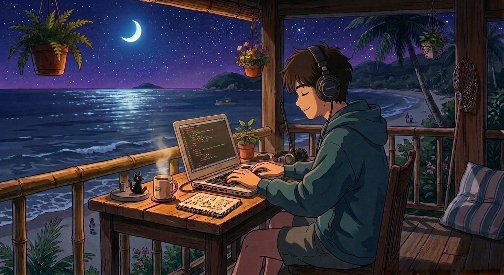
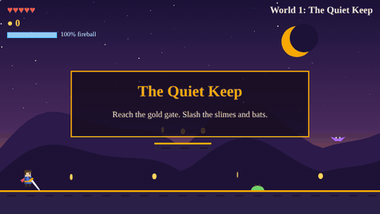

<div align="center">
  
</div>

<br/>

<div align="center">


<br/><br/>

[](https://www.instagram.com/apoorvmishra_07/)
[](https://www.youtube.com/@ApoorvMishra)
[](https://leetcode.com/u/Apoorv_M7/)
[](https://www.linkedin.com/in/apoorv-mishra07/)


</div>

---

## 🛡️ &nbsp; Character Sheet

<div align="center">

| | |
|:---|:---|
| **Name** | Apoorv Mishra |
| **Class** | B.Tech CSE (AI/ML), second year |
| **Guild** | University of Petroleum and Energy Studies (UPES) |
| **Graduating** | 2029 |
| **Active quest** | Landing a SWE or ML internship |
| **Training grounds** | Data Structures · Algorithms · Machine Learning |

</div>

> *"Every hard problem is a dungeon. Map it, clear one room at a time, and the boss turns out to be a loop you hadn't read closely."*

---

## 🎮 &nbsp; Play: The Quiet Keep

<div align="center">

[](https://quiet-keep.vercel.app)

[](https://quiet-keep.vercel.app)

Desktop and mobile · Built from scratch in plain JavaScript

A tiny Swordigo-style platformer with ten worlds: chain sword combos, throw fireballs at bats, collect orbs and gold, and fight through a new set of monsters in every world, a village shop, quests, and a guardian boss at the end of each.

</div>

---

## 📜 &nbsp; Quest Log

| Quest | What it is | Stack | Status |
|:---|:---|:---|:---:|
| 🥊 **Adaptive Fighter AI** | A fighting game where ML models learn the player's style, predict their next move, adjust difficulty and detect bots | Python, ML | ✅ Built |
| 🏰 **The Quiet Keep** | Side-scrolling sword platformer with ten worlds, new monsters in each, enemies, coins and touch controls | JavaScript, Canvas | ✅ Live |
| 🏒 **Air Hockey** | Arcade game from scratch: physics engine, collision logic, live rendering, AI opponent coming soon | Python | 🔧 In progress |
| 🌐 **UPES ACM Website** | Contributor on the React site for the UPES ACM chapter, [upesacm.org](https://upesacm.org) | React, Vite | ✅ Live |

<!-- TODO: add repo links, e.g. [Adaptive Fighter AI](https://github.com/apoorv-git-code/REPO) -->

---

## 🏆 &nbsp; Achievements Unlocked

- ⚔️ **Innov8, Eightfold.ai × ARIES (IIT Delhi):** qualified from the Corporate Heist prelims into the Battle Arena finals
- 💼 **CodeAlpha:** completed a software engineering internship in 2026

---

## 🎒 &nbsp; Inventory

<div align="center">

| 🗡️ Class | 🧰 Gear |
|:---:|:---:|
| **Weapons** (Languages) |     |
| **Spells** (ML / Data) |    |
| **Armor** (Web) |    |
| **Camp gear** (Tools) |    |
| **Vaults** (Databases) |  |

</div>

---

## 📊 &nbsp; Hero Stats

<div align="center">


<br/><br/>


</div>

---

## 🐍 &nbsp; The Serpent of Commits

<div align="center">
  <picture>
    <source media="(prefers-color-scheme: dark)" srcset="https://raw.githubusercontent.com/apoorv-git-code/apoorv-git-code/output/github-snake-dark.svg" />
    <source media="(prefers-color-scheme: light)" srcset="https://raw.githubusercontent.com/apoorv-git-code/apoorv-git-code/output/github-snake.svg" />
    
  </picture>
</div>

---

## 🍺 &nbsp; Find Me at the Tavern

<div align="center">  

I share the journey: the wins, the late-night debugging sessions, and the builds in between.

[](https://www.instagram.com/apoorvmishra_07/)
[](https://www.youtube.com/@ApoorvMishra)

<br/>

```python
while alive:
    read()
    code()
    level_up()
    repeat()
```

</div>

---

<div align="center">
  <sub>⚡ Powered by caffeine, curiosity, and one more quest · <b>@apoorv-git-code</b></sub>
</div>
